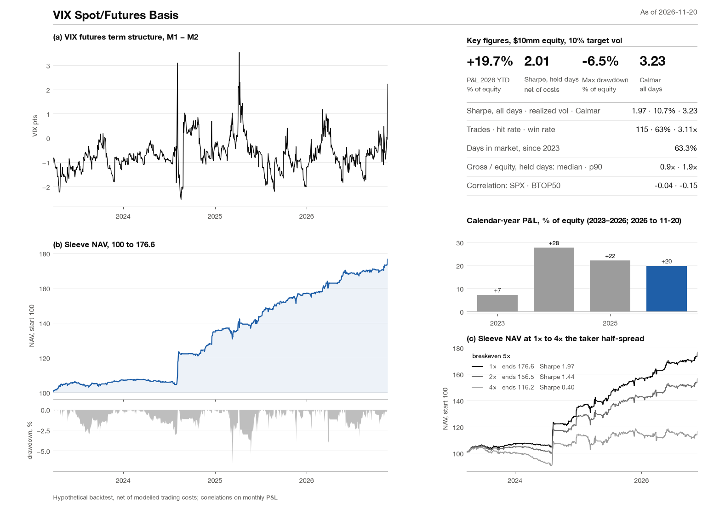
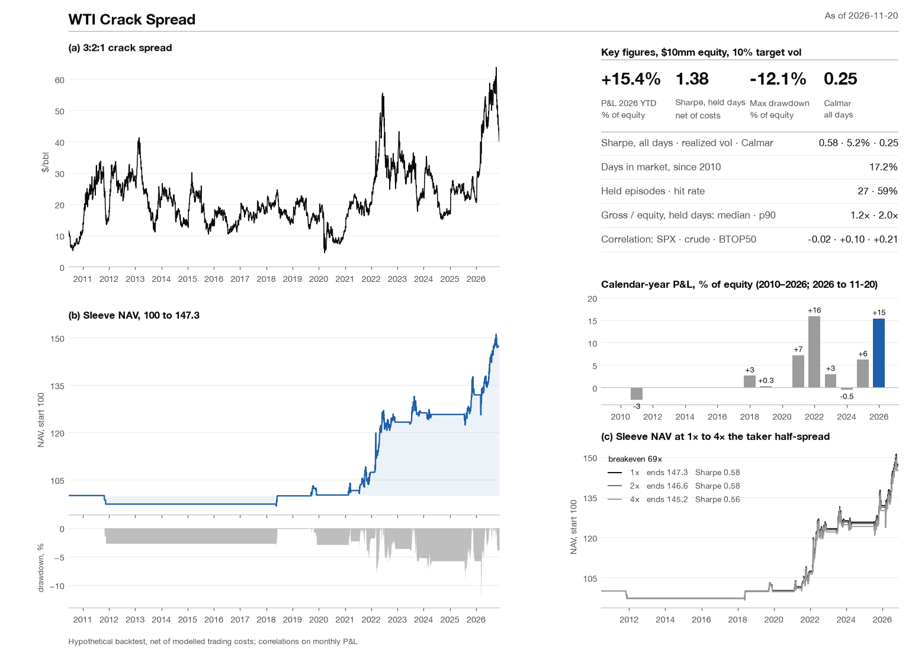
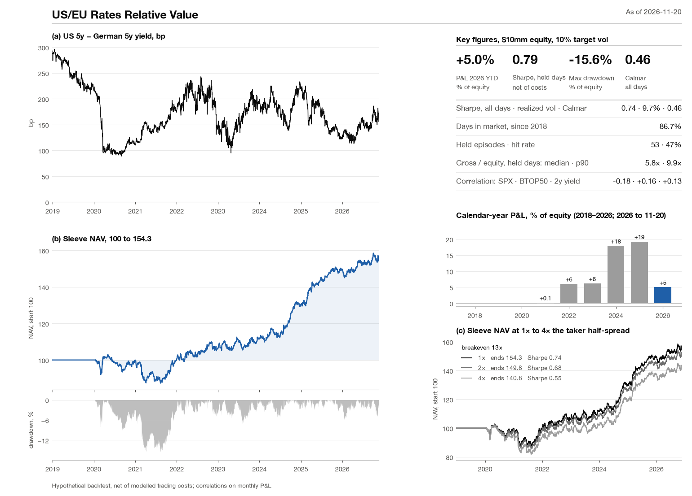
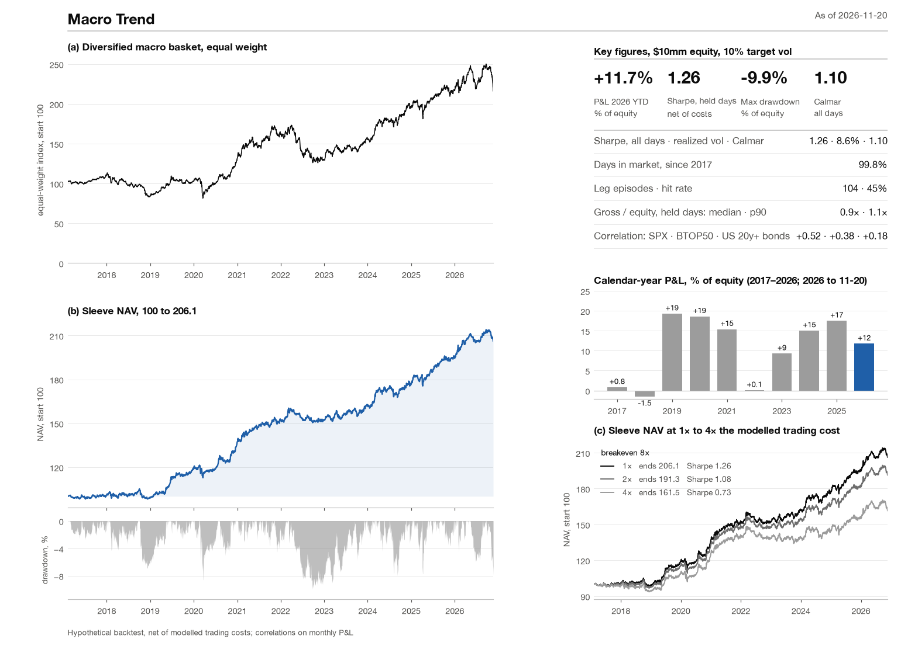

<!-- check subtitle comps on LNKD -->

## Systematic Macro Portfolio

- Styles: trend, carry, relative value
- Venues: NYSE, CME, CBOE, Eurex, CFE
- Asset Classes: equities, rates/STIRs, energy, FX, metals, agriculture
- Signals: causal filtering, volatility modeling, regime gates

<!-- link goes here -->

## Signal Sheets

<!-- sleeve-table -->

## 1. VIX Spot/Futures Basis {#fig1}

{alt="VIX spot/futures basis tear sheet"}

## 2. WTI Crack Spread {#fig2}

{alt="WTI 3:2:1 crack spread tear sheet"}

## 3. US/EU Rates Relative Value {#fig3}

{alt="US 5-year vs Bobl basis tear sheet"}

## 4. Macro Trend {#fig4}

{alt="Trend core tear sheet"}
