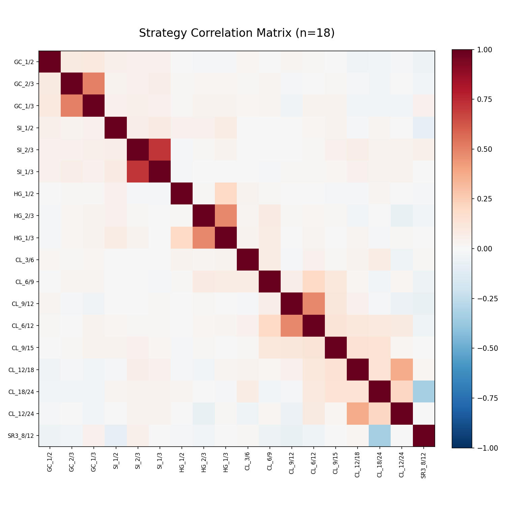
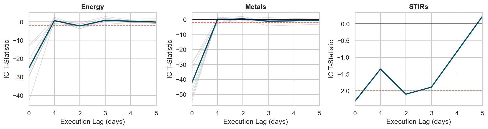
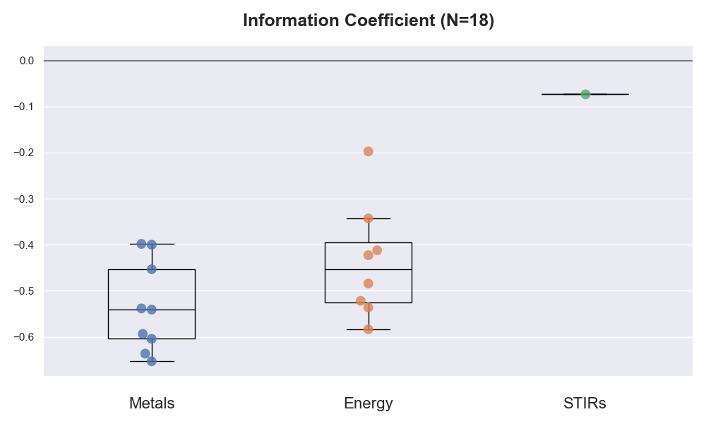
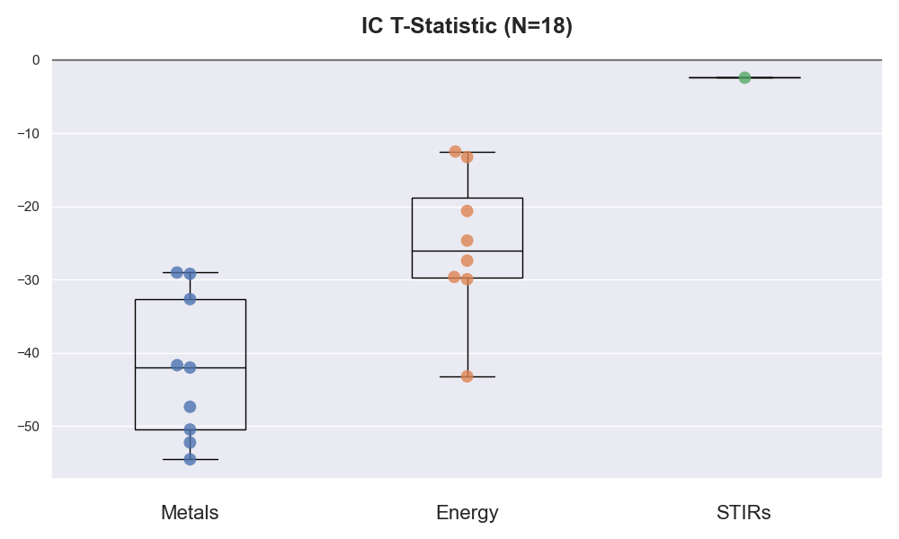
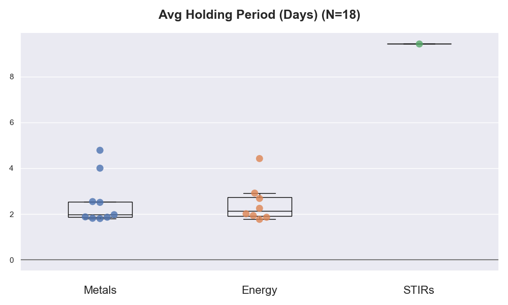
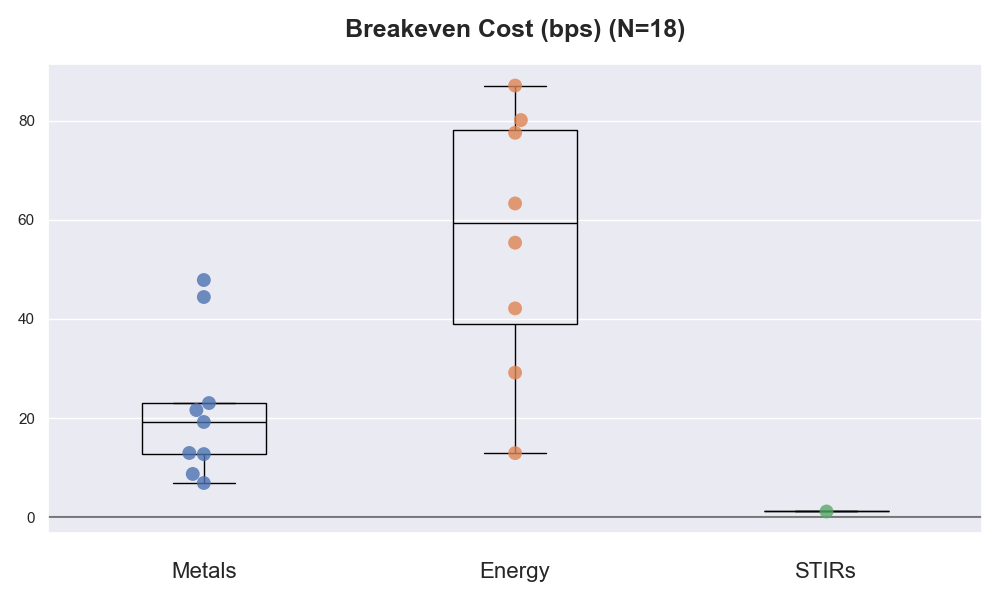
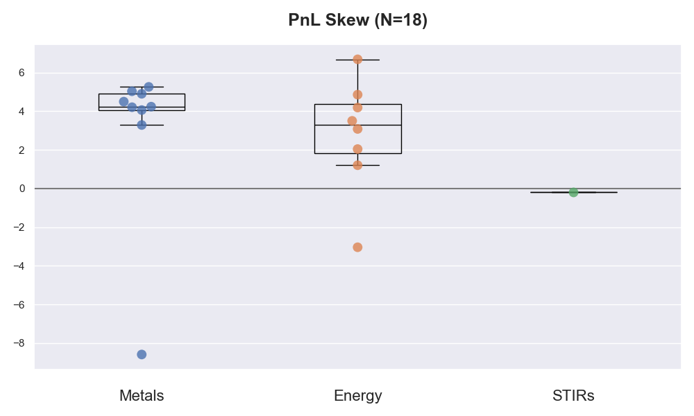
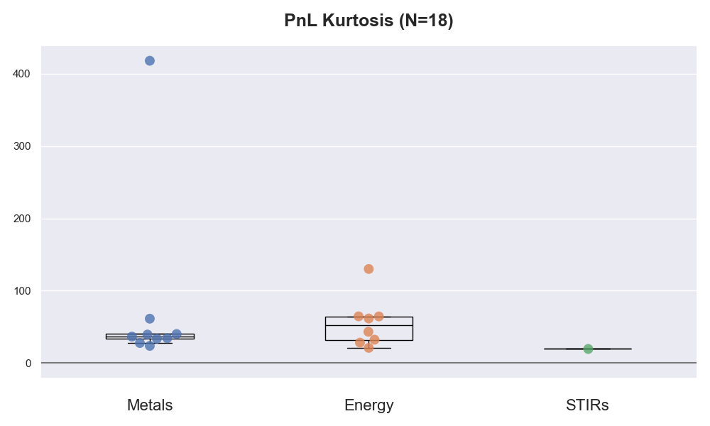

# Mean Reversion in Futures Curves with Storage Constraints

__Products__: Metals, Crude, STIRs  
__Strategy Type__: Systematic Relative Value  

## Summary
This research focuses on isolating mean-reverting signals in calendar spreads for liquid CME futures products.

Modeling is performed using a Kalman filter with GARCH(1, 1) risk adjustment and daily closing prices. Main results emphasize forecast quality and assume $T+0$ “close-to-close” execution, providing an estimated upper bound on realizable gross alpha. Breakeven costs are estimated using a 15% volatility target across spreads.

 

## Hypothesis
Supply and demand for physical commodities can exhibit trending behavior over time, with short-run stationary shocks. Inventories and storage warehouses and tanks act as the physical buffer for these shocks.

Because the shocks are stationary, demand for inventories and storage capacity is also inherently stationary and mean-reverting: as inventories expand toward finite capacity limits, the marginal cost of storage increases, creating an "elastic band" that pulls the cost back to equilibrium when the surplus clears.

Working (1949) defines the calendar spread in a storage-constrained market as the clearing price of holding inventory between dates; these spreads should therefore exhibit predictable mean reversion, creating a theoretical foundation for relative value trading.

Similar logic can be extended to STIR markets, where bank balance sheets play the role of storage, and regulatory limits like the Supplementary Leverage Ratio (SLR) create the capacity constraint: when a collateral shock consumes finite capacity, "balance sheet storage costs" drive spreads into a mean-reverting cycle.

 

## Key Results

* __18 of 20 spreads statistically significant__ (median IC = -0.50, IC t-stat = -29.78, ICIR = -3.67). STIRs are a highly efficient market, and only 1/3 spreads tested in this asset class produces a successful fit.

* __15 of 18 significant spreads exhibit positive PnL skew__ (median 4.15), validating the hypothesis that storage constraints impose mean reversion on spreads.

* __7 of 18 spreads show signal persistence__ lasting 2-5 days, specifically in the back end of the crude cure and in STIRs. Most spreads exhibit alpha decay by $T+1$, indicating intraday analysis as a next step.

* __Average holding periods of 2-9 days__ and __average round-trip breakeven costs of 1-90 bps__ suggest segmented execution strategies.

 

## Discussion

### Segmented Results
* __Crude spreads exhibit significant theoretical alpha__, driven by large, persistent dislocations. Realizable edge may be liquidity-constrained, suggesting higher-frequency analysis.

* __STIRs curves exhibit persistent signal, but are highly efficient__, making this signal valuable mainly as an execution overlay or queue positioning feature.

* __Metals have robust standalone properties__, balancing the strongest study-wide signal strength with lower breakevens and lower kurtosis than crude.

 

These tables show results across asset classes for the KF/GARCH filter:

 

::: {.text-left}
__Spread Metrics__
:::
|    | Metals | Crude | SOFR | Aggregate |
|--|:-:|:-:|:-:|:-:|
| Number of Spreads | 9 | 8 | 1 | 18 |
| Signal Autocorrelation (lag 1) | +0.07 | +0.08 | +0.70 | +0.07 |
: {.hover tbl-colwidths="[25,15,15,15,15]"}

 

::: {.text-left}
__Forecast Metrics__
:::
|    | Metals | Crude | SOFR | Aggregate |
|--|:-:|:-:|:-:|:-:|
| Information Coefficient | -0.54 | -0.45 | -0.07 | -0.50 |
| IC T-Statistic | -41.99 | -26.03 | -2.31 | -29.78 |
| ICIR | -4.44 | -3.30 | -1.09 | -3.67 |
: {.hover tbl-colwidths="[25,15,15,15,15]"}

 

::: {.text-left}
__Strategy Metrics__
:::
|    | Metals | Crude | SOFR | Aggregate |
|--|:-:|:-:|:-:|:-:|
| Avg Holding Period (Days) | 1.97 | 2.13 | 9.44 | 2.13 |
| Breakeven Cost (Bps) | 19.20 | 59.33 | 1.19 | 26.09 |
| PnL Skew | 4.23 | 3.29 | -0.20 | 4.12 |
| PnL Kurtosis | 36.50 | 52.41 | 19.99 | 37.92 |
: {.hover tbl-colwidths="[25,15,15,15,15]"}

 

::: {.text-left}
_Note: values are sample medians._
:::

 

### Benchmark Comparison
We compare the Kalman filter's forecasts to a Recursive Least Squares baseline.

The RLS model is also a recursive filter, but it differs from the Kalman filter in that it uses a single fixed bandwidth ("forgetting factor") rather than separate degrees of freedom for Q and R.

|  | Kalman Filter | RLS | Performance vs. Benchmark |
|--|:-:|:-:|:-:|
| Information Coefficient | -0.50 | -0.36 | __1.4x__ |
| IC t-statistic | -29.78 | -19.69 | __1.5x__
| IC Information Ratio | -3.67 | -3.56 | __1.0x__ |

: {.hover tbl-colwidths="[30,30,30,30]"}

::: {.text-left}
_Note: values are sample medians._
:::

Benchmark results show that the Kalman filter's forecasts are approximately __40% more correlated__ with future returns and __50% more statistically significant__ than the RLS baseline.

The flat ICIR indicates that while the Kalman Filter produces more edge than the baseline, it is a higher variance model. This is consistent with the __bias-variance tradeoff__ between structurally similar 1- and 2- parameter models.

 

### PnL Correlation Matrix

Spread PnL series exhibit marginal correlations.

* There is some unavoidable positive correlation between overlapping spreads.
* Different segments of the crude curve have low correlations.
* Negative correlation arises between asset classes, most prominently between STIRs and the back end of the crude curve.

{width=400 fig-align="center" .lightbox}

 

### PnL Convexity
A central finding is that a large majority (15/18) of spreads exhibit __positive PnL skew__.

* Unlike most mean-reverting strategies, this produces a  __long-convexity__ risk profile.
* This effect persists even without GARCH or stop loss, indicating that it is a property of the signal rather than the model.
* This supports the core hypothesis that these spreads are structurally mean-reverting.
* Negative convexity arises in short-dated skews, where "spot gamma" effects distort predictable mean-reversion, and marginally in STIRs.

|    | Aggregate | Aggregate (no GARCH) | Aggregate (no GARCH, no Stop Loss) |
|--|:-:|:-:|:-:|
| PnL Skew | 4.12 | 4.26 | 3.99 |
| PnL Kurtosis | 37.92 | 43.34 | 39.86 |
: {.hover tbl-colwidths="[15,30,25,30]"}

::: {.text-left}
_Note: values are sample medians._
:::

 

## Methodology

__Backtest__

* We use a __vectorized expanding-window backtest__ using data from June 2010 to Sep 2025, with basic mean-reverting trading rules.

* Spread series are created from raw outright prices using a fixed (product-specific) calendar-based roll schedule to approximate constant-maturity spreads, avoid First Notice Dates, and simulate liquid execution.

* The Kalman filter’s recursive nature is used to avoid lookahead bias by using prior predictive forecasts only.

* Instead of using a stitching technique to address __roll gaps__ we keep the raw data unaltered and rely on __adaptive filtering via process noise injection__, delivering a shock to the filter to allow it to rapidly adjust to the new spread level. The shock is parameterized as a vector,  preventing rolls from affecting factor betas.

* Returns and signals are zeroed-out on roll dates to prevent artifacts from affecting the signal or forecasts.

 

__Modeling__

* Curve level effects are __orthogonalized__ using 1-month contracts where possible (e.g. for longer-dated spreads). We avoid front-month contracts  due to their increased volatility and "spot gamma" exposure.

* Curve slope effects are orthogonalized for the belly of the STIRs curve, which is strongly tied to the front end, but these hedges are omitted where possible to avoid complex hedging strategies. Overall results indicate that the strategy does not exploit "carry beta" exposure with low-frequency holding periods.

* The Kalman filter's state space consists of the spread level and  factor betas (when present). The process noise Q is parameterized as a vector, allowing factor betas to vary slowly while the spread is noisier. An arcsinh transformation is applied to filter inputs for robust variance conditioning for model fitting, and inverted before performance measurement calculations.

* __Filter tuning__ is handled for each spread by estimating the observation noise R from the filter's innovation variance over an initial burn-in period, and then selecting the value of Q consistent with a fixed bandwidth (Q/R ratio) across spreads.

 

## Next Steps 

* Results strongly suggest __intraday analysis__ (e.g., 5-min bars) to test filter performance in a mid-frequency environment.

* Incremental changes could enable __additional products__, adding to breadth and diversification:

    * Seasonal factors for calendar spreads in grains and energy distillates (ZS, ZC, ZW, RB, HO, NG).
    * Lagged time-zone awareness for inter-market geographic spreads (WTI/Brent).
    * Fundamental data for inter-market processing spreads (Crack Spread, Soy Crush).
    * Fundamental data for soft commodities.

* The study's theoretical framework omits the dynamics of scarcity convexity and the __convenience yield__. These could be integrated by reparameterizing the Kalman filter to estimate a __vector regression__ (Gibson-Schwarz 1990, Schwarz-Smith 2000), potentially offering a lower-bias fit, reduced regime dependence and improved left-tail behavior. The present combination of state space model with GARCH correction is essentially a reduced-form version of this.

 

## Visualizations

__Alpha Decay__

{fig-align="center" .lightbox}

 

__Forecast Metrics__

::: {layout-ncol=2}

{.lightbox}

{.lightbox}

:::

 

__Strategy Metrics__

::: {layout-ncol=2}
{.lightbox}

{.lightbox}
:::

 

::: {layout-ncol=2}
{.lightbox}

{.lightbox}
:::

 

